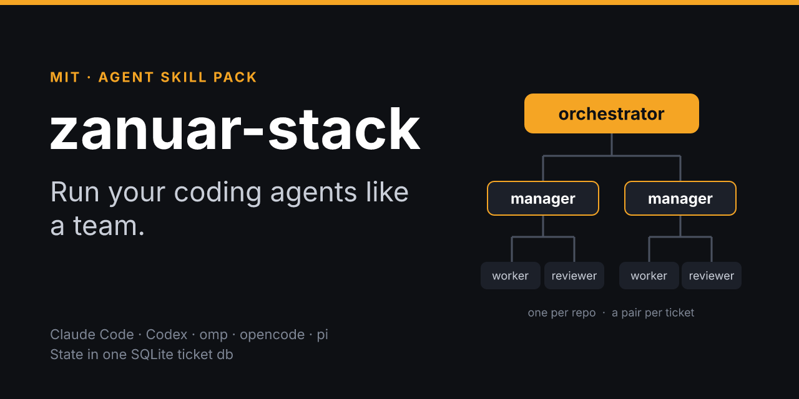

# zanuar-stack



A skill pack for running coding agents as a small team: one **orchestrator** across repos, one **manager** per repo, and a **worker** plus **reviewer** per ticket. Built for [Orca](https://github.com/stablyai/orca) first, but the skills only assume a harness that can start another agent and pass messages, so they work elsewhere too.

```
                 owner
                   │  decisions only
                   ▼
             orchestrator ── interview → story + one brief per repo
        ┌──────────┼──────────┐
        ▼          ▼          ▼
     manager    manager    manager      one per repo, kept open
      │    │
      ▼    ▼
   worker reviewer                      one ticket, own worktree/branch
      │    ▲
      └────┘  FIX rounds (max ~3) → PASS → PR
```

Shared state is one SQLite file, `~/.orca/tickets/tickets.db` (see [`db/`](db/README.md)): stories, tickets, runs, per-repo role config.

## Skills

| role skills | |
|---|---|
| [`orchestrator`](skills/orchestrator/SKILL.md) | cross-repo planning, briefs, escalation; never codes |
| [`manager`](skills/manager/SKILL.md) | tickets, dispatch, triage, review loop, PR |
| [`worker`](skills/worker/SKILL.md) | one ticket, verify, report |
| [`reviewer`](skills/reviewer/SKILL.md) | full-diff review, PASS or FIX |

| practice skills | |
|---|---|
| [`interview`](skills/interview/SKILL.md) | one-question-at-a-time requirements interview |
| [`big-plan`](skills/big-plan/SKILL.md) | design the workflow for large or unattended work |
| [`brief`](skills/brief/SKILL.md) | make a task deeper, then rewrite it |
| [`shape-first`](skills/shape-first/SKILL.md) | sketch types and boundaries before code |
| [`cut-first`](skills/cut-first/SKILL.md) | subtract before you add |
| [`root-cause`](skills/root-cause/SKILL.md) | fix where it first went wrong |
| [`test-first`](skills/test-first/SKILL.md) | failing regression test, then fix |
| [`ripple-check`](skills/ripple-check/SKILL.md) | what breaks outside the diff, proven |
| [`comment-sweep`](skills/comment-sweep/SKILL.md) | delete comments that don't earn their place, encode real constraints |
| [`make-verify`](skills/make-verify/SKILL.md) | repo-local recipe to launch the app and prove a feature (optional) |
| [`decision-log`](skills/decision-log/SKILL.md) | auditable trail in the db or a TSV |
| [`setup-zanuar-stack`](skills/setup-zanuar-stack/SKILL.md) | run once: ticket db + who plays each role |
| [`adopt`](skills/adopt/SKILL.md) | take over a PR or branch, keep credit |
| [`open-pr`](skills/open-pr/SKILL.md) | short, readable PRs |
| [`watch-pr`](skills/watch-pr/SKILL.md) | own a PR through CI and review |
| [`pr-comments`](skills/pr-comments/SKILL.md) | attributed, direct PR comments |

Harness wiring: [`adapters/orca`](adapters/orca/README.md).

## Installation

Pick **one** route per agent. A plugin updates itself; skills.sh and manual copies are files you own and update by hand. Installing both gives you every skill twice.

### Claude Code (plugin, updates itself)

```sh
claude plugin marketplace add zanuartri/zanuar-stack
claude plugin install zanuar-stack@zanuar-stack
```

### Codex (plugin, updates at startup)

```sh
codex plugin marketplace add zanuartri/zanuar-stack
codex plugin add zanuar-stack@zanuar-stack
```

Both read the same `.claude-plugin/` manifests, which point at `skills/`. A new release reaches users when `version` in `.claude-plugin/plugin.json` changes.

### Everything else (skills.sh, manual updates)

```sh
npx skills@latest add zanuartri/zanuar-stack -g -a pi
```

Replace `pi` with the agent ID from the table.

| agent | `-a` id | lands in |
|---|---|---|
| OpenCode | `opencode` | `~/.config/opencode/skills` |
| Pi | `pi` | `~/.agents/skills` |
| Command Code | `command-code` | `~/.commandcode/skills` |

Take every skill, including `setup-zanuar-stack`. Update with `npx skills@latest update -g`, and re-run `add` to pick up new skills. `-a '*'` or omitting `-a` covers any other agent skills.sh knows.

### oh-my-pi (omp): manual copy

skills.sh has no omp target. Copy the folders into omp's skills dir, `~/.omp/agent/skills`:

```sh
git clone https://github.com/zanuartri/zanuar-stack "${TMPDIR:-/tmp}/zanuar-stack"
mkdir -p "$HOME/.omp/agent/skills"
cp -R "${TMPDIR:-/tmp}/zanuar-stack/skills/." "$HOME/.omp/agent/skills/"
```

On Windows PowerShell:

```powershell
git clone https://github.com/zanuartri/zanuar-stack $env:TEMP\zanuar-stack
New-Item -ItemType Directory -Force $HOME\.omp\agent\skills
Copy-Item -Recurse -Force $env:TEMP\zanuar-stack\skills\* $HOME\.omp\agent\skills\
```

Pull and copy again to update.

### Then, once per machine

Run **`/setup-zanuar-stack`**. It creates `~/.orca/tickets/tickets.db`, finds the harnesses you have, and asks who plays manager, worker and reviewer (harness, model, effort, mode). Then start a session with the `orchestrator` skill (several repos) or the `manager` skill (one repo).

## Credits

The ideas here are adapted, in our own words, from:

- [herdr-rig](https://github.com/zanuartri/herdr-rig): the orchestrator / manager / worker / reviewer roles.
- Matt Pocock's "grill me" pattern: the `interview` skill.
- Poteto's pstack ([cursor/plugins/pstack](https://github.com/cursor/plugins/tree/main/pstack), mirror [backnotprop/pstack](https://github.com/backnotprop/pstack)): `figure-it-out`, `sharpen`, `architect`, `show-me-your-work`, `tdd`, `principle-fix-root-causes`, `principle-subtract-before-you-add`, `blast-radius` → `big-plan`, `brief`, `shape-first`, `decision-log`, `test-first`, `root-cause`, `cut-first`, `ripple-check`. Also `no-comments` → `comment-sweep`, and `create-verification-skill` + `maintain-verification-skill` → `make-verify`, both adapted from Poteto's pstack (cursor/plugins/pstack).
- [t3dotgg/tstack](https://github.com/t3dotgg/tstack): `takeover`, `file-pr`, `babysit-pr`, `leaving-pr-comments` → `adopt`, `open-pr`, `watch-pr`, `pr-comments`.

## License

MIT, see [LICENSE](LICENSE).
